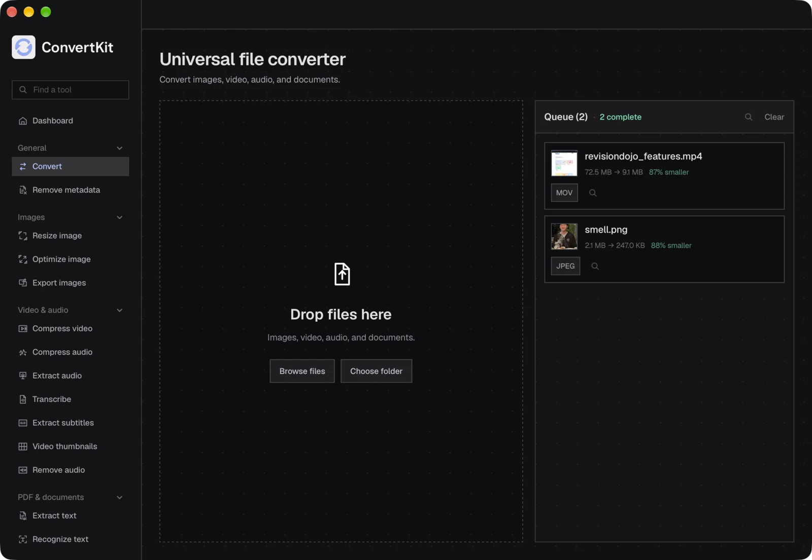
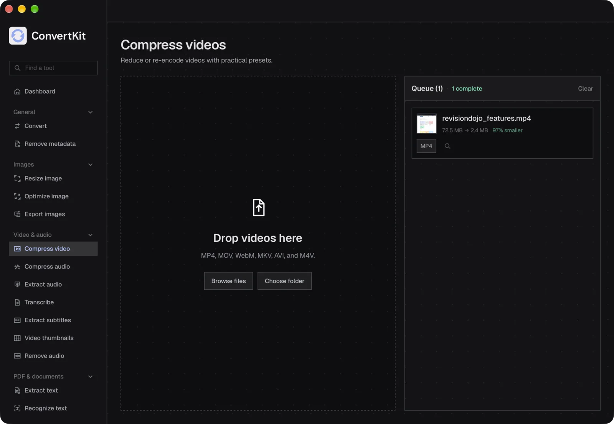
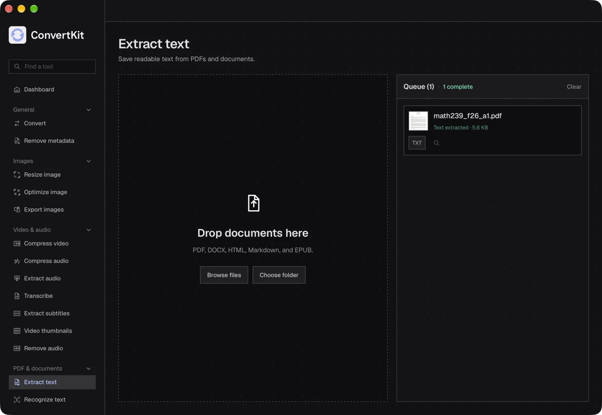
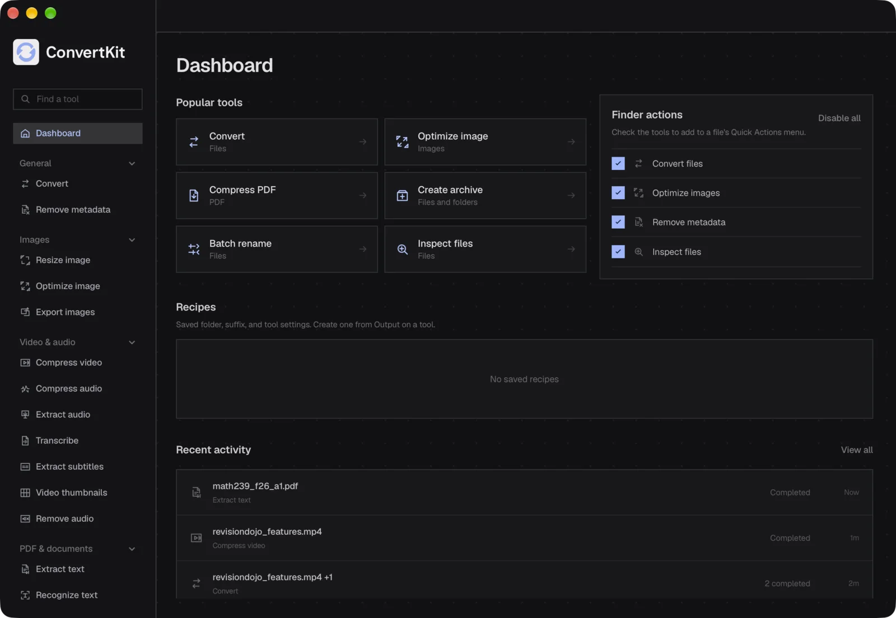

# ConvertKit

A Rust macOS app with 22 file tools, from video compression and Whisper transcription to PDF splitting. It all runs offline on your Mac. Apple Silicon only.

[Download the latest release](https://github.com/dawsonxiong/ConvertKit/releases/latest/download/ConvertKit_aarch64.dmg). On first launch, choose Open Anyway in System Settings > Privacy & Security.



## Tools

| Area | Tools |
| --- | --- |
| General | Convert, Remove metadata |
| Images | Resize, Optimize, Export variants |
| Video & audio | Compress video, Compress audio, Extract audio, Transcribe, Extract subtitles, Video thumbnails, Remove audio |
| PDF & documents | Extract text, Recognize text, Combine to PDF, Split PDF, Export PDF pages, Compress PDF |
| Organize | Create archive, Extract archive, Batch rename, Inspect files |

Results are saved as new files, so your originals stay as they were. You can pin tools to the sidebar, save recipes, and add Finder Quick Actions from the dashboard.

## Screenshots

| Compressed video, 97% smaller | Extract text from a PDF | Dashboard and recent activity |
| :-: | :-: | :-: |
|  |  |  |

## How it works

The React side builds a job and asks Rust over Tauri IPC whether the engines it needs are installed. Rust then runs it through the bundled FFmpeg, ImageIO helper, Pandoc or whisper.cpp and streams progress back as events.

If a conversion only changes the container, like MP4 to MOV with the same codecs, ffprobe spots that and the file gets remuxed instead of re-encoded, which is pretty much instant.

## Convert

The formats in Convert come from `src/lib/formatMatrix.json`, and a backend test checks that every option has an engine behind it.

| Kind | Inputs | Outputs | Engine |
| --- | --- | --- | --- |
| Raster | JPEG, PNG, WebP, TIFF, BMP, GIF, ICO, AVIF, HEIC | Other rasters, SVG, or one-page PDF (PNG/JPEG) | Bundled ImageIO helper, vtracer (built in), bundled Quartz helper |
| SVG | SVG | Raster formats | resvg (built in) |
| Video | MP4, MOV, WebM, MKV, AVI | Other video, GIF, or audio | FFmpeg (bundled) |
| Audio | MP3, WAV, AAC, FLAC, OGG, M4A | Other audio | FFmpeg (bundled) |
| Documents | DOCX, HTML, Markdown, EPUB, TXT | Other documents, including PDF | Pandoc and Tectonic (bundled), LibreOffice (optional) |
| PDF | PDF | Use the PDF tools, not Convert | Bundled PDFKit helper, lopdf (built in) |

Image, video, audio, transcription and PDF tools work without installing anything:

- A bundled ImageIO helper decodes and resizes images and writes PNG, TIFF, BMP, GIF, AVIF and HEIC.
- Linked-in libraries write JPEG (mozjpeg), WebP including animation (libwebp) and ICO, render SVG (resvg) and trace rasters to SVG (vtracer).
- Optimize uses built-in lossless passes: oxipng for PNG, a coefficient transcode for JPEG (what jpegoptim does) and frame differencing for GIF (what gifsicle does).
- FFmpeg ships inside the app, built from pinned sources with x264, x265, libvpx, opus, lame and vorbis (see License).
- A bundled PDFKit helper reads page info, renders pages and extracts text. Split, extract and combine copy pages losslessly with lopdf, and Compress PDF downsamples images to 300, 150 or 72 ppi and re-encodes them with mozjpeg.

ImageMagick is never required. It is only used, if installed, for AVIF or HEIC output on a macOS release whose ImageIO cannot encode them.

Document conversion uses the bundled Pandoc and Tectonic. DOCX to PDF uses LibreOffice when it is installed, because it keeps the layout, and otherwise falls back to Pandoc. Tectonic downloads TeX support files the first time it builds a PDF and caches them, so the first PDF needs an internet connection.

If an engine is missing, you find out before the job starts. There's no PDF to DOCX.

## Stack

Rust, Tauri 2, Tokio, React, TypeScript, Vite, Zustand, Tailwind v4, FFmpeg, whisper.cpp.

## Running locally

You'll need an Apple Silicon Mac, Rust, Node 22 and pnpm, plus these:

```sh
brew install pkg-config
brew install --cask libreoffice   # optional, for layout-faithful DOCX to PDF
```

The package smoke tests (`pnpm package:smoke:apple-silicon`) also build their fixtures with `ffmpeg`, `imagemagick`, `poppler` and `ghostscript`. The app itself does not use them.

The packaged app comes with its own Whisper runtime, FFmpeg, Pandoc and Tectonic. The first `pnpm native:helpers` (run by every `pnpm tauri build`) compiles FFmpeg, its codecs and whisper.cpp from pinned, checksummed sources, which takes several minutes; later runs reuse the build. The Tiny, Base and Small models download the first time you use them.

```sh
pnpm install
pnpm tauri dev
```

| Command | What it does |
| --- | --- |
| `pnpm tauri dev` | Run the desktop app |
| `pnpm tauri build` | Production DMG |
| `pnpm test` | Frontend tests |
| `pnpm check` | Type-check |
| `pnpm lint` | Lint |
| `pnpm format` | Format |
| `pnpm native:helpers` | Build the OCR, PDF and ImageIO helpers, FFmpeg and Whisper |
| `pnpm package:smoke:apple-silicon` | Ad-hoc arm64 package gate |
| `pnpm release:doctor` | Check signing/notarize tooling |
| `pnpm release:macos` | Sign, notarize, and staple the DMG |

To open the app with a test fixture already loaded (Vite only):

```sh
pnpm tauri dev --no-watch --config \
  '{"build":{"beforeDevCommand":"","devUrl":"http://127.0.0.1:1420/?fixture=encodeVideo"}}'
```

## Release

Output: `src-tauri/target/release/bundle/dmg/ConvertKit_<version>_<arch>.dmg`, plus an upload folder, `src-tauri/target/release/upload/<version>/`, holding exactly the release assets under their published names.

Signing credentials come from 1Password. Export the `op://` references rather than the keys themselves:

```sh
export CONVERTKIT_SIGNING_IDENTITY_REF='op://VAULT/ITEM/signing identity'
export CONVERTKIT_APPLE_API_ISSUER_REF='op://VAULT/ITEM/issuer id'
export CONVERTKIT_APPLE_API_KEY_ID_REF='op://VAULT/ITEM/key id'
export CONVERTKIT_APPLE_API_PRIVATE_KEY_REF='op://VAULT/ITEM/private key'
```

Then `pnpm release:doctor`, `pnpm release:check`, and `pnpm release:macos`.

The upload folder holds `ConvertKit_aarch64.dmg` (the notarized DMG without its version, so the download link above always points at the latest release) and `ConvertKit_<version>_third-party-source.tar.gz`. Attach both to the GitHub release. Publish the source archive with every DMG: it is the GPL Corresponding Source for the bundled FFmpeg (the exact source tarballs and the script that built them) and Pandoc (its source at the shipped tag). `sh scripts/package-third-party-sources.sh` rebuilds it on its own.

## Shortcuts

| Shortcut | Action |
| --- | --- |
| `Cmd+K` | Find a tool |
| `Cmd+O` | Open files |
| `Enter` | Run the active tool |
| `Esc` | Cancel processing |
| `Cmd+R` | Reveal completed outputs in Finder |
| `←/→/↑/↓` | Change a focused selector |
| `Home/End` | First or last selector option |

Enter and Esc don't do anything while a form field or selector is focused.

## License

ConvertKit is MIT-licensed.

The bundled FFmpeg is licensed under the GNU GPL, version 2 or later, because it includes x264 and x265. It runs as separate `ffmpeg` and `ffprobe` executables. Its licences and the versions of every component are in `ConvertKit.app/Contents/Resources/ffmpeg-runtime/` (`NOTICE.txt` and `licenses/`), and its source is published with each release as described under Release.

The bundled Pandoc is also GPL, version 2 or later, and Tectonic is MIT-licensed. Both are the projects' own macOS release binaries, shipped unmodified, with their licences and checksums in `ConvertKit.app/Contents/Resources/document-runtime/`. Pandoc's source is in the same per-release archive.

H.264 and HEVC are covered by patent pools, and x264 and x265 come with no patent licence. That is a separate matter from the GPL, and worth checking before selling ConvertKit.
